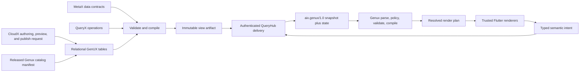

# Genux architecture

Status: active implementation. The pure-Dart contract/compiler, transactional
state store, ten-component Form Essentials catalog and native renderers, runtime
session, MultiView coordinator, and native showcase with a full-catalog Component
Lab exist. Aix transport, durable caching, advanced form validation, and CloudX
publishing remain future slices.

## Decision

Genux is the native Flutter runtime frontend for Aix mobile and desktop
applications. It is a deterministic, metadata-driven UI system first and a
bounded GenUI/A2UI target later. Flutter web is outside the product target.

The central doctrine is:

> Dynamic UI does not mean schema-less UI.

CloudX authors normalized relational metadata and initiates publication. A
trusted server-side compiler validates and compiles that metadata into a compact
immutable artifact stored in Aix. QueryHub combines the artifact with authorized
runtime state and delivers the snapshot. Genux validates and compiles the wire
snapshot once, then renders trusted Flutter implementations from resolved runtime
handles.

The backend never sends Dart, Flutter class names, SQL, HTTP endpoints, scripts, or
general expressions.

## System ownership



The boundaries are deliberate:

- **CloudX** owns authoring, catalog inspection, validation feedback, preview,
  publish/rollback initiation, and revision-history presentation.
- **Aix** owns authentication, authorization, DomainX scope, MetaX data contracts,
  QueryX execution, server validation, and business transactions.
- **Genux** owns the Flutter shell, released component catalog, compiled runtime
  model, bindings, local UI state, rendering, caching, navigation mediation, and
  action dispatch.
- **GenUI/A2UI** will be another constrained producer. It does not become the
  persistence model or rendering foundation.

Genux is never an authorization boundary. Hiding or disabling a control improves
the experience but does not grant or deny server authority.

## Two compilation boundaries

There are two related but separate compilations.

### Publication compilation

After CloudX initiates publication, the trusted server compiler reads a View
revision from normalized tables, resolves pinned Partial Views, verifies MetaX and
QueryX references, validates it against an exact catalog release, flattens and
namespaces the node graph, and writes an immutable JSONB artifact with a content
hash into Aix.

This compilation is deterministic. Recompiling the same revision with the same
compiler and catalog must produce the same canonical bytes and hash.

### Client compilation

The native Flutter client treats every delivered snapshot as untrusted. It performs a
strict wire decode, catalog and policy validation, graph validation, JSON Pointer
compilation, action resolution, and deep freezing. Only a successful result can
replace the current last-known-good render plan.

The renderer therefore receives:

- resolved component definitions rather than component-name lookups;
- parsed JSON Pointers rather than path parsing during `build`;
- resolved event-to-action handles rather than string joins;
- validated properties and channel values; and
- normalized child IDs in known slots.

Raw JSON never enters a component builder.

## Runtime model

The v1 snapshot contains one View surface:

- an exact `aix.genux/1.0` schema identifier;
- a stable View identity and immutable revision;
- an exact catalog release;
- one flat node map with a single root;
- initial JSON-compatible state;
- component properties and channel bindings; and
- typed semantic actions referenced by events.

Node identity is stable across compatible revisions so Flutter keys can preserve
focus, editing controllers, animations, selection, and scroll anchors. Published
Partial Views are pinned by revision and flattened with deterministic namespaced
IDs before delivery.

### MultiView coordination

MultiView is composition above the wire format, not an expansion of it. Every
successful `GenuxViewCoordinator.open` loads and compiles another complete
`aix.genux/1.0` document, verifies that it is the requested full View, activates a
new `GenuxSurfaceSession`, and appends one local stack entry. The stack therefore
contains independent documents, roots, state stores, and sessions; a document
never contains several screen roots.

A target is identified by `(viewCode, instanceKey)`. Its finite JSON parameters
are deeply immutable and are available to the trusted source loader, but they are
not automatically injected into document state. Pushing a View preserves every
prior session. Popping reveals the exact previous session and its current local
state rather than recompiling or resetting it.

Pending opens are latest-request-wins. A newer open or any back intent prevents
older asynchronous source work from committing. Load, compile, or View-identity
failure leaves the current last-known-good entry unchanged. The implemented rules
and deferred policies are specified in [MultiView runtime](multiview.md).

## Catalog doctrine

Flutter contains the trusted implementation of every component and template. A
released catalog declares their public contracts:

- immutable component code and version;
- typed configuration properties;
- typed `input` and `state` channels;
- typed events and payloads;
- named slots and cardinality;
- validation and resource limits; and
- accessibility and behavioral expectations.

The release pipeline will export a canonical catalog manifest from Genux and
import it into the Aix catalog tables. CloudX can only author against an imported
immutable release. The manifest hash stored in Aix must match the Flutter catalog
hash; neither side silently invents missing members. The current pre-v1 catalog
uses a checked development fingerprint until that exporter is implemented.

Production payloads should prefer semantic macro components and templates over
large trees of layout primitives. A `CustomerEditor`, `DataGrid`, or `OrderTimeline`
can use slivers, custom painting, focus management, animations, and responsive
layout internally while the wire document stays compact.

The current `aix.core@1` release surface is deliberately small: `Column`, `Text`,
`ComboBox`, `Button`, `Form`, `TextField`, `Checkbox`, `Row`, `Card`, and
`Divider`. Each has a native implementation registered from the same catalog used
by compilation. Form Essentials adds controlled string/boolean editing and bounded
composition without introducing reflection or an expression language. Form v1
also presents busy and error state and emits keyboard lifecycle intents; it does
not run MetaX validation or infer actions from slotted buttons.

The native [`component.lab` revision 1](../assets/views/component-lab.genux.json)
fixture is the executable catalog specimen. Its 43 nodes and 13 actions render all
ten component types and exercise all 47 top-level catalog properties, channels,
events, and slots. This is member coverage, not a claim that every allowed enum
value or nested `ChoiceItem` presentation is implemented. See
[Component Lab](component-lab.md) for the exact boundary.

## Binding and state

Genux keeps useful ideas from .NET binding without adopting reflection,
`DataContext`, or a general binding language. A component contract contains four
member kinds:

- `input`: reactive read-only data;
- `state`: reactive read/write data;
- `event`: typed user or lifecycle intent; and
- `slot`: structural children.

Configuration is supplied through `props`. An input channel may receive either a
literal in `props` or a JSON Pointer in `bind`. A state channel must bind to a
state path. Direction comes from the catalog, so documents do not repeat
`OneWay`/`TwoWay` flags.

The detailed rules are in [Binding model](binding-model.md).

Runtime state follows this flow:

```text
state snapshot -> Flutter build -> user intent -> atomic state transaction
               -> one change notification -> affected node rebuilds -> action
```

Document revision and local state version are separate. Widgets own ephemeral
Flutter state such as focus, hover, animation, and scroll position. The surface
store owns shareable form and display state. Aix remains authoritative for saved
business data.

## Actions and data operations

Wire actions use semantic capability names such as `customer.save` or
`order.open`. They do not contain QueryX IDs, URLs, methods, routes, SQL, or Dart
callbacks.

During authoring, relational call records may reference QueryX and ParamX through
foreign keys. Publication compiles those details into a server-side capability
mapping and exposes only the semantic contract to the client. Dispatch goes
through a local capability registry and the typed Aix adapter. The backend
authenticates, authorizes, validates, and deduplicates every operation again.

Navigation follows the same rule. The implemented showcase registers semantic
`view.open` and `view.back` capabilities, checks that the invocation belongs to the
current session, resolves an allowlisted stable View code, and then calls the
pure-Dart coordinator. The coordinator does not interpret capability names. A
document cannot name an arbitrary Flutter route, URL, or source-loader target.

## Native shell and dynamic surfaces

The mobile/desktop application shell remains trusted native Flutter code. At
minimum it owns:

- bootstrap and compatibility negotiation;
- authentication and session recovery;
- update-required, offline, denied, and fatal states;
- top-level navigation and deep-link policy;
- cache ownership and last-known-good activation; and
- diagnostics, telemetry, and feature flags.

Genux Views occupy explicit surfaces within that shell. The system can eventually
render most business screens dynamically without making startup and recovery
dependent on a remote document.

## Reusable engine and showcase

The repository is both a reusable private package and the reference native app.
`package:genux/genux.dart` exposes the pure-Dart catalog, compiler, validation,
state, runtime session, and View coordinator. `package:genux/genux_flutter.dart`
adds the Flutter registry, Material implementations, and `GenuxSurfaceHost`.

The showcase consumes those public exports to provide a live MultiView Customer
Workspace with a bottom navigation bar (JSON editor and runtime preview). The
Workspace opens `customer.edit` revision 6, `customer.summary` revision 1,
`customer.list` revision 1, and `component.lab` revision 1 as independent
documents. **Open Component Lab** reaches the live 43-node catalog specimen;
interactions update its isolated state and record local `demo.event` intents.
Returning from either child View reveals the exact retained editor session. The
showcase is an executable specification and integration harness, not a second
rendering path. A feature is not considered integrated when it only works in
showcase-specific widgets.

## Performance strategy

- Compile strings and bindings once before activation.
- Keep the visible document immutable and replace it atomically.
- Subscribe node hosts to intersecting state paths, not the whole surface.
- Batch all writes in a state transaction into one version and notification.
- Keep large collections as data and render them with builder-based slivers; do
  not create one metadata node for every row.
- Preserve node and item keys across compatible snapshots.
- Cache canonical artifacts, compiled plans where safe, state, and assets—not
  Flutter `Widget` instances.
- Use high-level templates for animation-heavy or layout-heavy experiences.
- Move decoding off the UI isolate only after payload benchmarks demonstrate a
  benefit.

The first performance fixtures will be a long virtualized data view and a large
interactive form with lookup controls, validation, dirty state, and submit.

## Validation and failure behavior

A candidate snapshot passes all gates before activation:

1. transport byte limit and strict JSON syntax;
2. exact schema and catalog compatibility;
3. component property, channel, event, and slot types;
4. graph uniqueness, ownership, reachability, cycle, depth, and count limits;
5. binding syntax, initial values, and channel direction;
6. semantic action references and local capability policy; and
7. source-specific security and resource policy.

Failure returns structured diagnostics. It never partially updates the current
surface. For MultiView, the candidate is not appended until load, compile,
full-View identity verification, and activation succeed. The shell retains the
last-known-good View or a bundled native fallback.

## Future GenUI/A2UI path

GenUI is integrated in increasing order of freedom:

1. select an existing published View;
2. select and parameterize a published Partial View;
3. propose a restricted patch against a draft;
4. compose a new relational draft using the released catalog.

Agent output must pass the same publisher and runtime validation. Generated
definitions remain drafts until explicitly published. A version-pinned A2UI
adapter can also normalize a bounded subset into the client draft model, but it
cannot bypass the compiler or register Flutter code dynamically.

## Initial code boundaries

The project remains one private Flutter package until real consumers exercise the
boundaries:

```text
lib/genux.dart
lib/src/catalog/      released component contracts
lib/src/model/        strict wire draft and JSON Pointer types
lib/src/validation/   semantic and policy validation
lib/src/compiler/     resolved immutable runtime plan
lib/src/state/        transactional path-aware state store
lib/src/runtime/      surface sessions, capability dispatch, and View coordination
lib/src/flutter/      registry, SurfaceHost, NodeHost, Material renderers
lib/src/aix/          QueryHub transport and capability adapter (later)
lib/showcase/         native reference and experiential application
```

The first external consumer can now integrate the public
compiler/coordinator/session/host seam while the Aix transport adapter is
developed.

## Delivery sequence

1. **Core contract (implemented):** strict draft, catalog, validator, compiled
   render plan, fixtures, and diagnostics.
2. **State and ComboBox slice (implemented):** atomic path-aware store, Flutter
   registry, controlled `ComboBox`, and event-after-commit behavior.
3. **Form Essentials (implemented):** controlled `TextField`, `Checkbox`, `Row`,
   `Card`, and `Divider`, plus Form busy/error presentation and keyboard lifecycle
   events, in the revision-6 customer editor and Component Lab.
4. **MultiView (implemented):** one document/session per stack entry, immutable
   target parameters, retained-session back navigation, latest-request-wins race
   protection, semantic navigation mediation, and the revision-1 customer summary.
5. **Component Lab (implemented):** independent View with structural coverage
   for all 12 aix.core@2 catalog members (73 nodes total).
6. **DataView foundation (implemented):** evaluation context with explicit binding
   sources (state, item, event), CollectionView component with list/grid layouts,
   Expanded component for bounded layout, and aix.core@2 catalog release.
7. **Advanced form behavior:** MetaX-backed client rules, coordinated commit and
   explicit update policies, submit validation/gating, and server error mapping.
8. **DataGrid component:** two-dimensional virtualization, column management,
   measured cells, sorting, filtering, selection, and keyboard navigation.
9. **Aix delivery:** bootstrap negotiation, QueryHub adapter, durable caching,
   offline selection/restoration, and production capability dispatch.
10. **CloudX publishing:** relational editor, deterministic compiler, preview,
   publish, rollback, and catalog release import.
11. **GenUI pilot:** bounded View/Partial selection and draft composition behind a
   feature flag.
