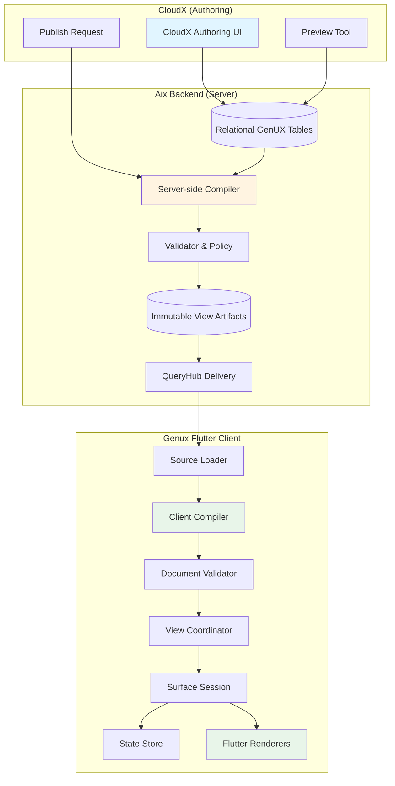
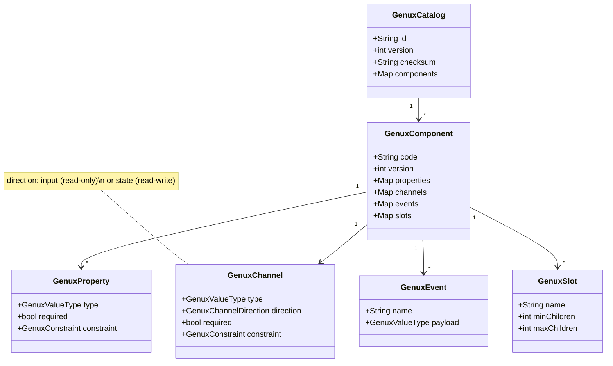
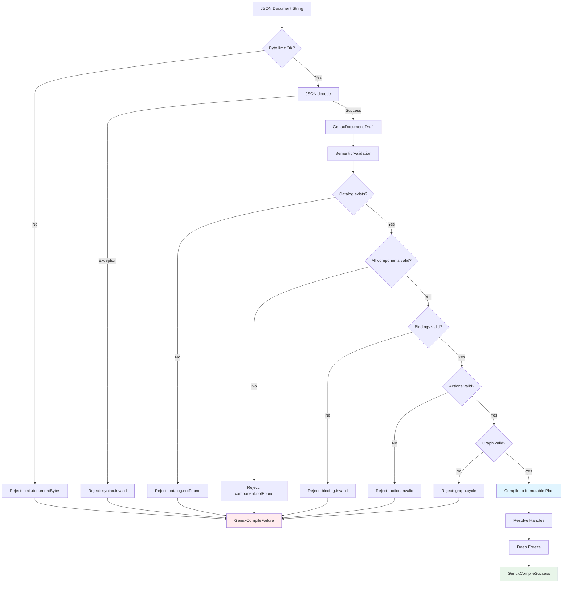
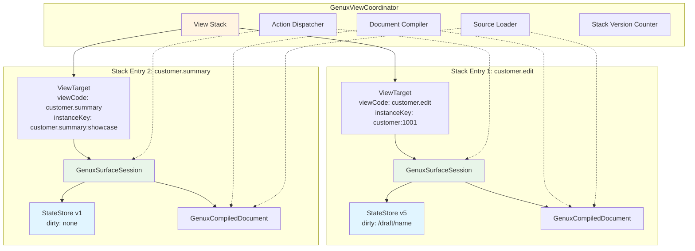
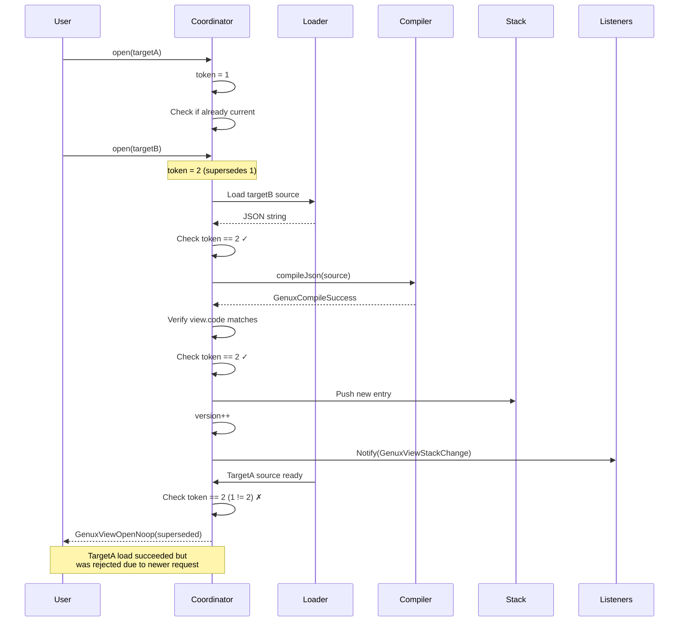
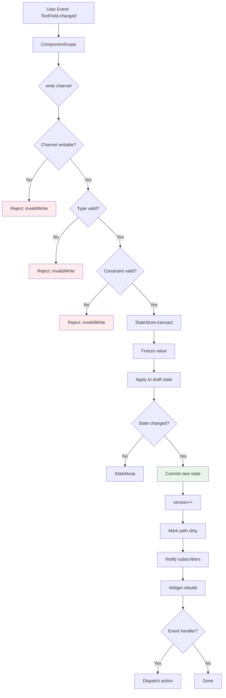
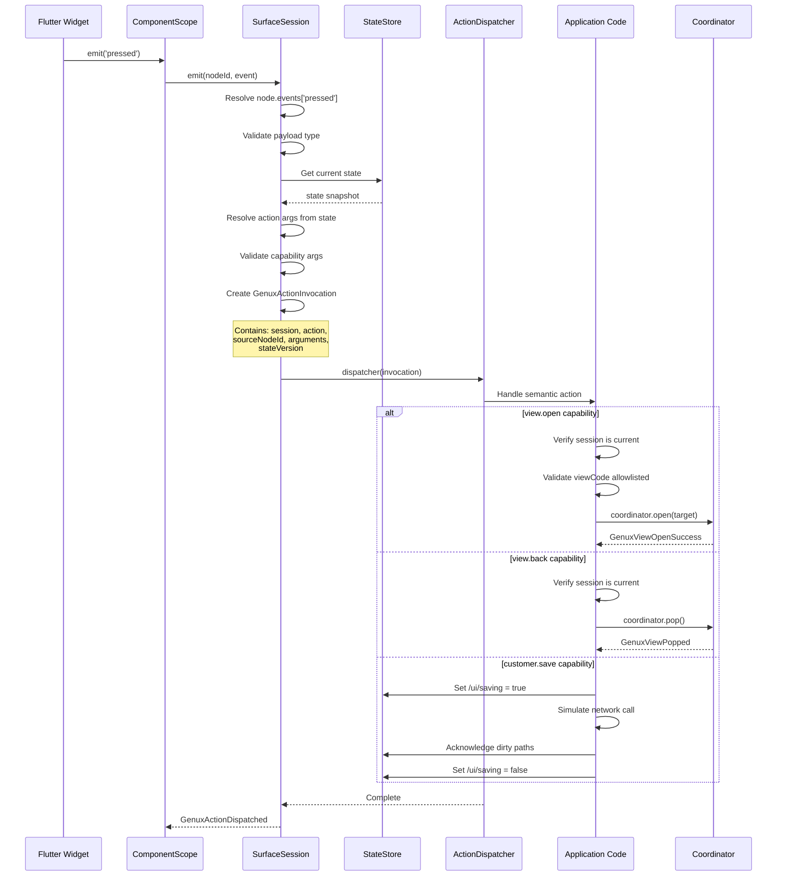
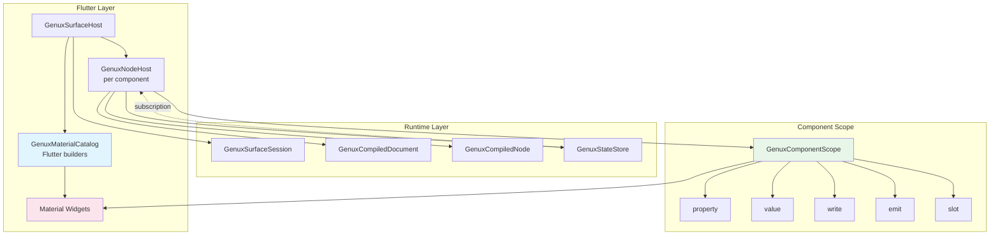
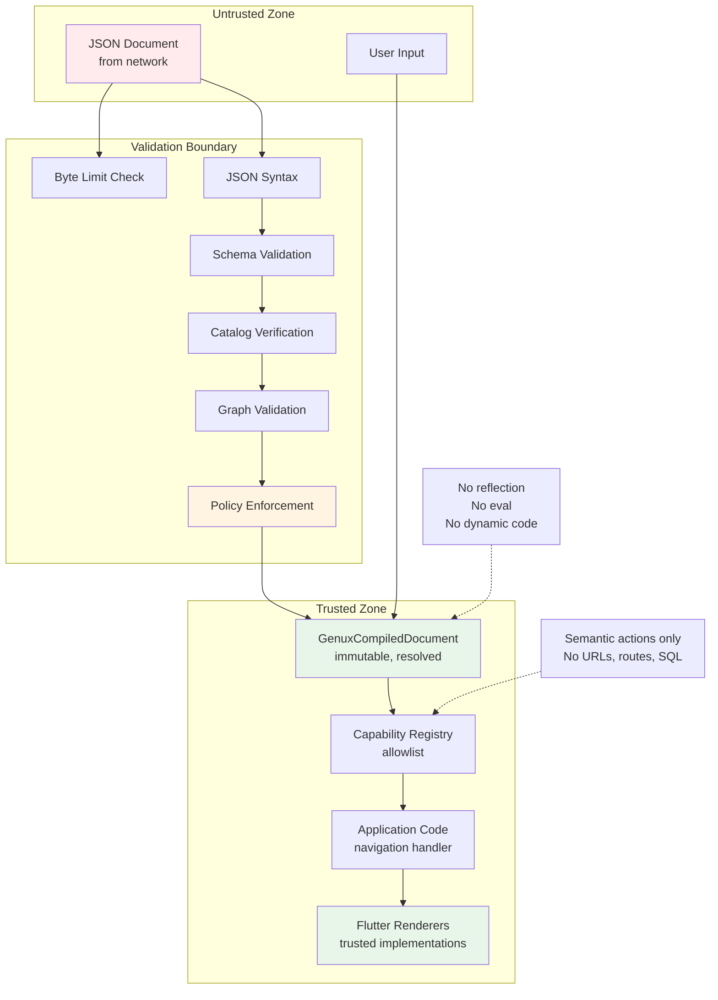
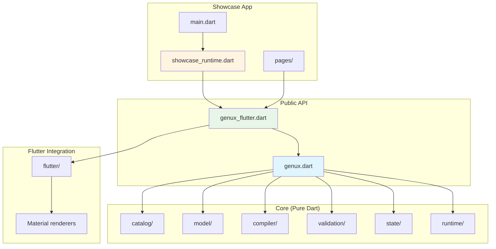

# Genux Architecture Diagrams

## System Overview



## Wire Protocol: aix.genux/1.0

```mermaid
graph LR
    subgraph "Document Structure"
        Doc[aix.genux/1.0 Document]
        View[View Identity]
        Catalog[Catalog Reference]
        Root[Root Node ID]
        State[Initial State JSON]
        Actions[Action Definitions]
        Nodes[Node Graph]
    end
    
    Doc --> View
    Doc --> Catalog
    Doc --> Root
    Doc --> State
    Doc --> Actions
    Doc --> Nodes
    
    View --> |view.code|VC[customer.edit]
    View --> |view.revision|VR[6]
    View --> |view.kind|VK[view]
    
    Catalog --> |catalog.id|CI[aix.core]
    Catalog --> |catalog.version|CV[1]
    Catalog --> |catalog.checksum|CS[sha256:...]
    
    State --> |JSON paths|SP[/draft/name<br/>/ui/saving<br/>/lookups/types]
    
    Nodes --> |Component instances|N1[Form]
    Nodes --> N2[TextField]
    Nodes --> N3[Button]
    
    style Doc fill:#fff4e1
    style View fill:#e1f5ff
    style Catalog fill:#fce4ec
    style State fill:#e8f5e9
```

## Component Catalog Model



## Compilation Pipeline



## MultiView Stack Model



## Open Pipeline with Race Protection



## State Transaction Flow



## Action Dispatch Flow



## Binding Resolution

```mermaid
graph TB
    subgraph "Document Structure"
        Node[Node: TextField]
        Binding["bind: {value: '/draft/name'}"]
        State["state: {draft: {name: 'Mya'}}"]
    end
    
    subgraph "Compilation"
        Compile[Compile Time]
        Pointer[GenuxJsonPointer<br/>segments: ['draft', 'name']]
        CompiledBinding[GenuxCompiledBinding<br/>pointer: /draft/name<br/>definition: TextField.value]
    end
    
    subgraph "Runtime"
        Build[Widget Build]
        Read[Read binding]
        Traverse[Traverse state path]
        Value[value = 'Mya']
        Render[Render TextField]
    end
    
    Node --> Binding
    Binding --> Compile
    State --> Compile
    Compile --> Pointer
    Pointer --> CompiledBinding
    
    CompiledBinding --> Build
    State --> Build
    Build --> Read
    Read --> Traverse
    Traverse --> Value
    Value --> Render
    
    style Compile fill:#fff4e1
    style Build fill:#e8f5e9
    style Value fill:#e1f5ff
```

## Component Rendering Architecture



## Security Boundaries



## Project Structure



