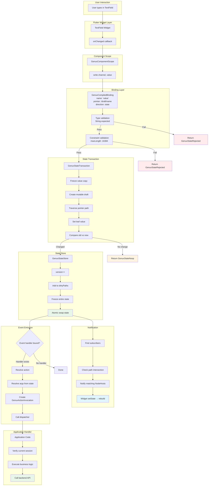
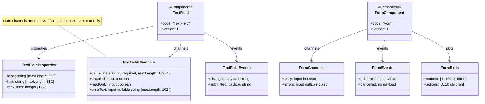
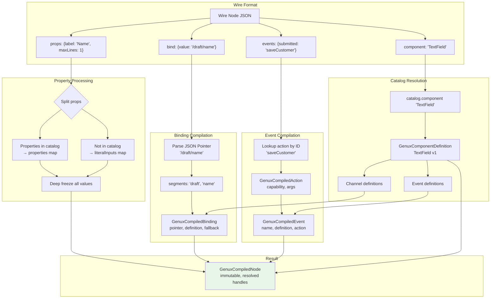
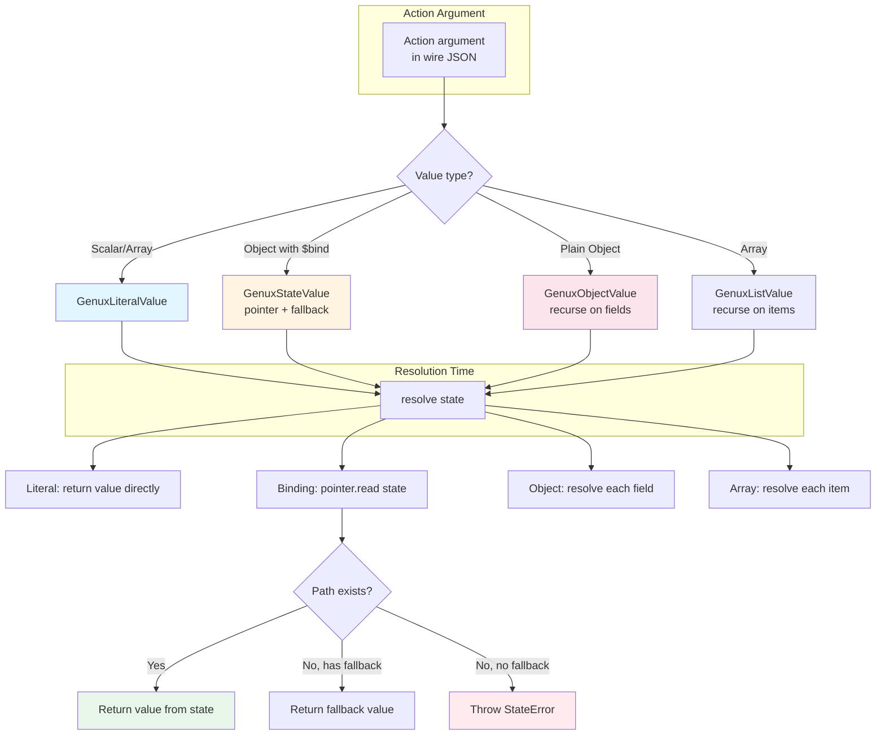
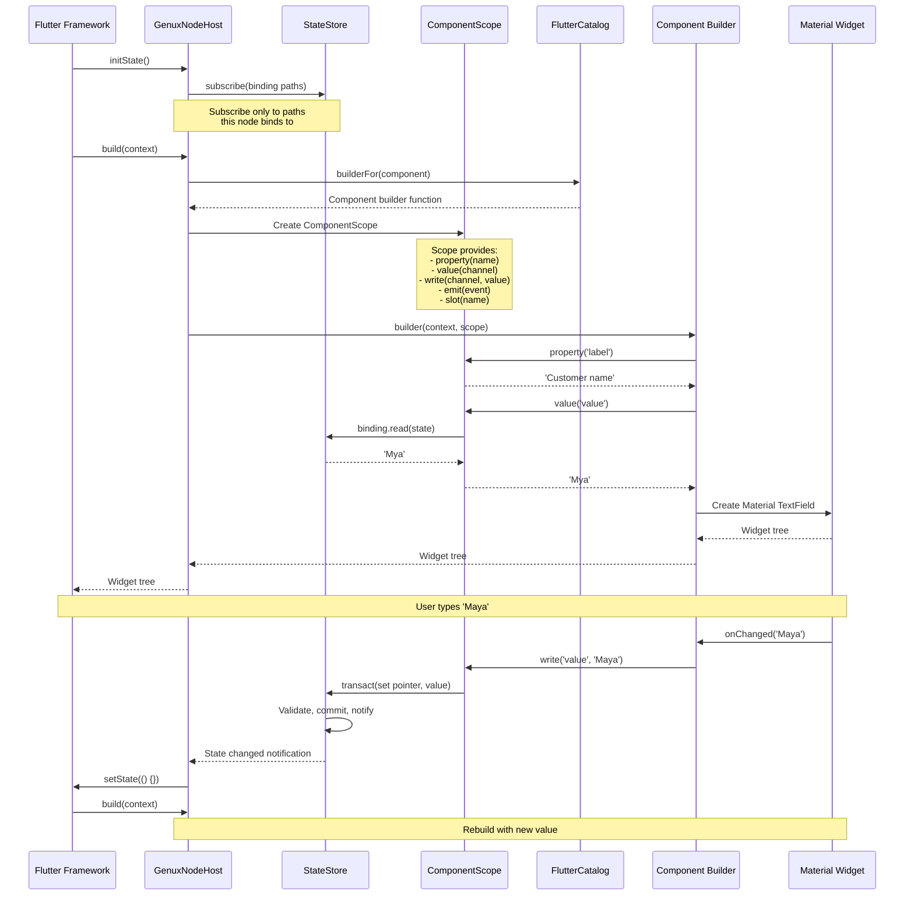
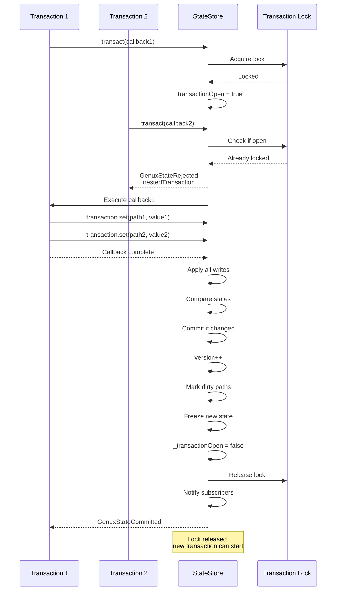
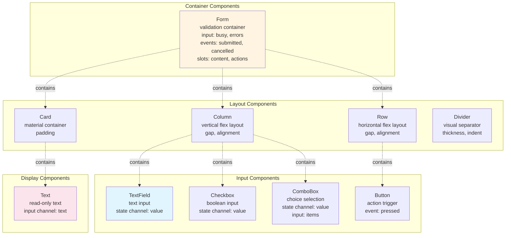
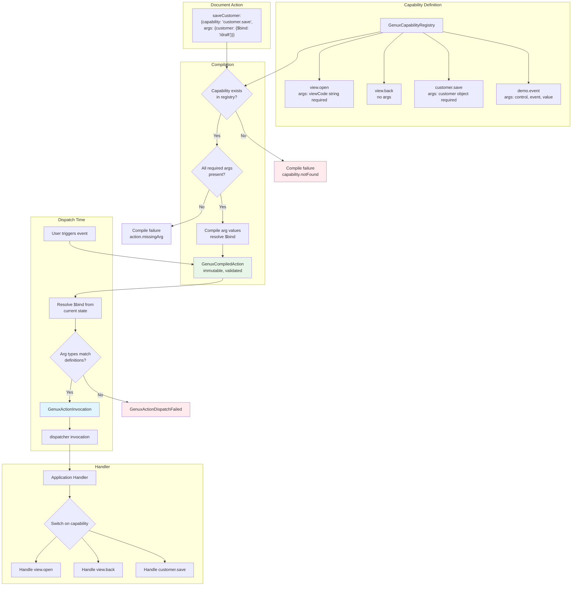
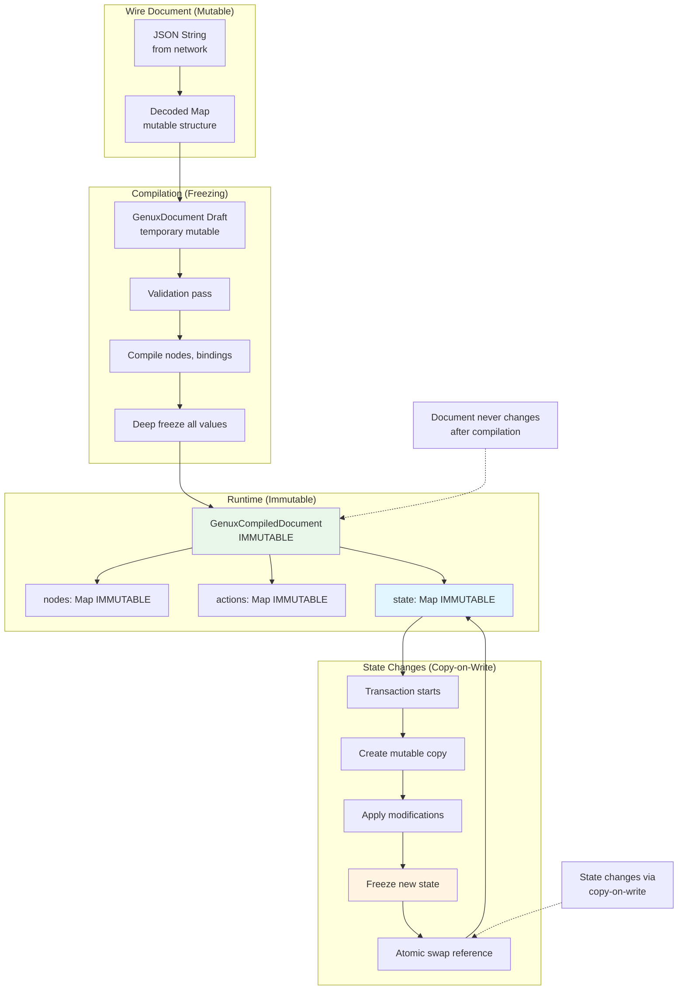
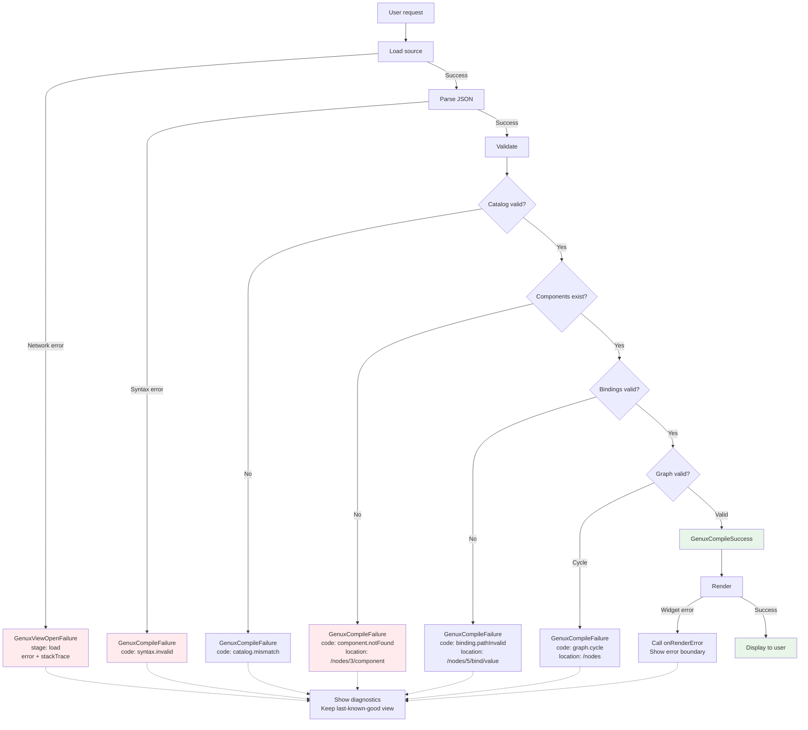

# Data Flow & Component Model Diagrams

## Complete Data Flow: User Input to Server



## Catalog Component Definition Model



## Node Compilation Process



## Value Resolution: Literal vs Binding vs Expression



## Component Rendering Lifecycle



## JSON Pointer Path Resolution

```mermaid
flowchart TD
    Start[State: {draft: {name: 'Mya', type: 2}}] --> Pointer[Pointer: /draft/name]
    
    Pointer --> Split[Split by /<br/>segments: 'draft', 'name']
    Split --> Current[current = root state]
    
    Current --> Segment1[Traverse: 'draft']
    Segment1 --> Check1{current is Map?}
    Check1 -->|No| Error1[Throw: not a collection]
    Check1 -->|Yes| Get1[current = current'draft']
    
    Get1 --> Exists1{Key exists?}
    Exists1 -->|No| NotFound[Return: exists=false]
    Exists1 -->|Yes| Segment2[Traverse: 'name']
    
    Segment2 --> Check2{current is Map?}
    Check2 -->|No| Error2[Throw: not a collection]
    Check2 -->|Yes| Get2[current = current'name']
    
    Get2 --> Exists2{Key exists?}
    Exists2 -->|No| NotFound
    Exists2 -->|Yes| Found[Return: exists=true<br/>value='Mya']
    
    style Found fill:#e8f5e9
    style NotFound fill:#fff4e1
    style Error1 fill:#ffebee
    style Error2 fill:#ffebee
```

## State Store Transaction Isolation



## 10 Core Components Overview



## Capability Registry & Dispatch



## Memory Model: Immutability



## Error Handling & Diagnostics



