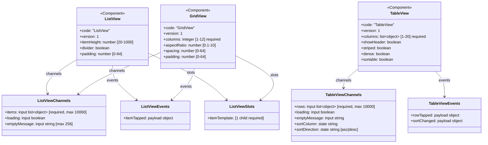
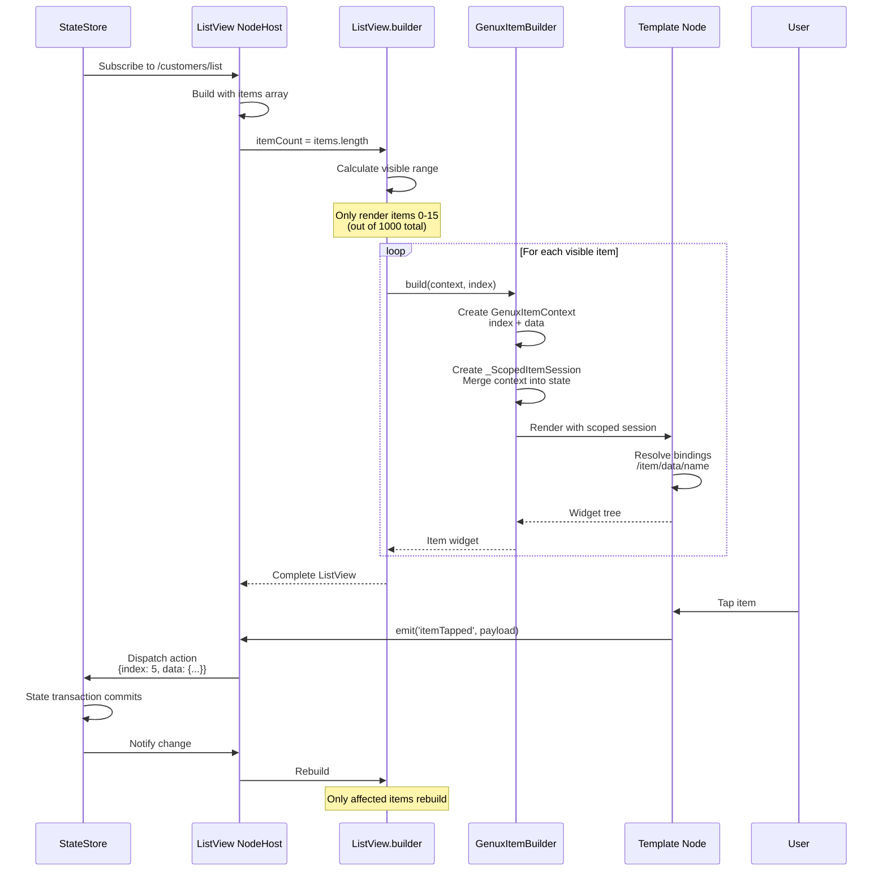
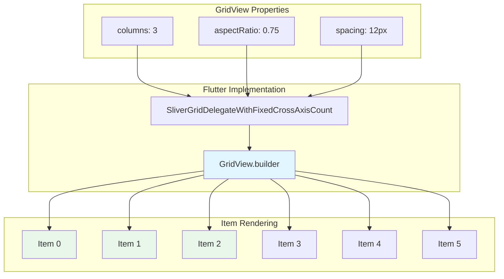
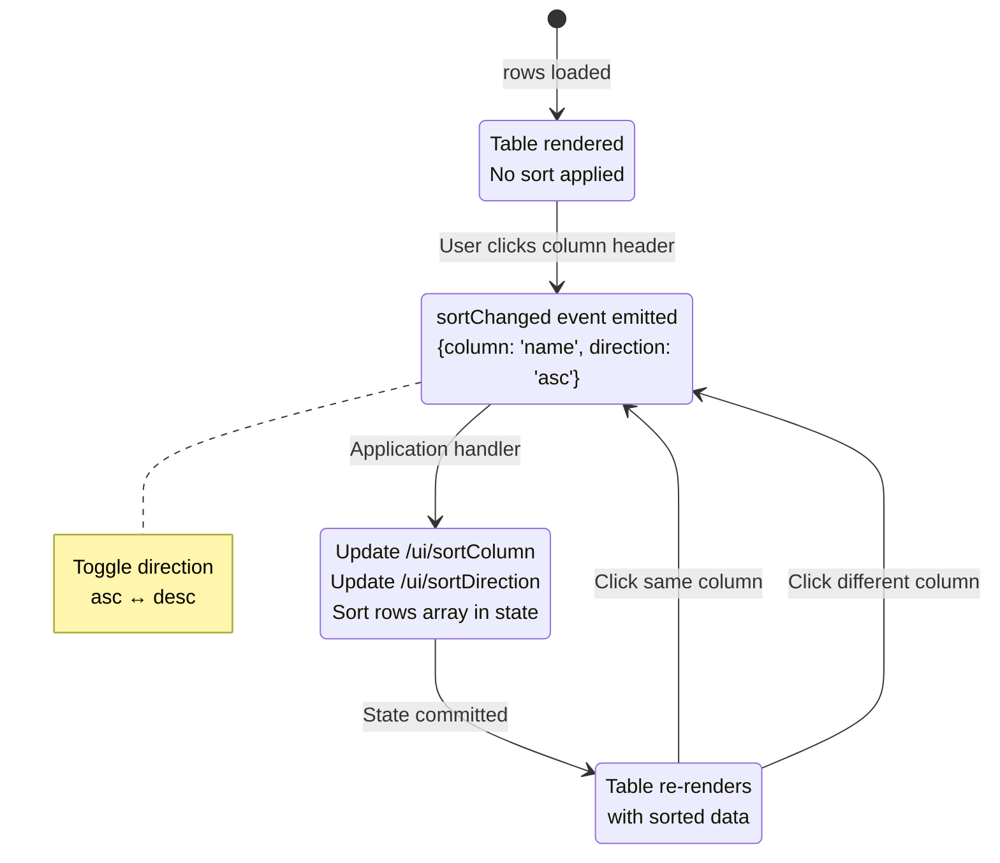
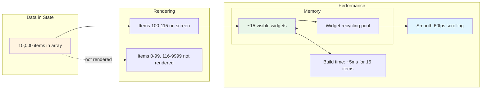
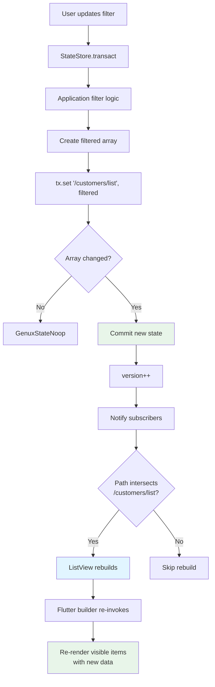

# DataView Components Architecture

## Overview

DataView components provide high-performance, virtualized rendering of large collections in Genux. These components extend the core catalog with ListView, GridView, and TableView.

## Architecture Diagrams

### DataView Component Model



### Item Context Binding Model

```mermaid
flowchart TB
    subgraph "State Structure"
        State[State: /customers/list]
        Items[Array of Objects]
    end
    
    subgraph "ListView Node"
        ListView[ListView Component]
        Binding[items binding: /customers/list]
    end
    
    subgraph "Virtualized Rendering"
        Builder[Flutter ListView.builder]
        Visible[Render visible items only]
        ItemBuilder[GenuxItemBuilder per item]
    end
    
    subgraph "Item Context"
        Context[GenuxItemContext]
        ItemIndex[index: 0, 1, 2...]
        ItemData[data: object]
    end
    
    subgraph "Template Rendering"
        Template[Item Template Node]
        SpecialPaths[Special Binding Paths]
        ItemIndexPath[/item/index]
        ItemDataPath[/item/data]
        ItemFieldPath[/item/data/name]
    end
    
    subgraph "Scoped Session"
        ScopedSession[_ScopedItemSession]
        ScopedStore[_ScopedStateStore]
        MergedState[Base state + item context]
    end
    
    State --> Items
    Items --> Binding
    Binding --> ListView
    ListView --> Builder
    Builder --> Visible
    Visible --> ItemBuilder
    
    ItemBuilder --> Context
    Context --> ItemIndex
    Context --> ItemData
    
    Context --> ScopedSession
    ScopedSession --> ScopedStore
    ScopedStore --> MergedState
    
    MergedState --> Template
    Template --> SpecialPaths
    SpecialPaths --> ItemIndexPath
    SpecialPaths --> ItemDataPath
    SpecialPaths --> ItemFieldPath
    
    style ListView fill:#e1f5ff
    style Context fill:#fff4e1
    style MergedState fill:#e8f5e9
```

### ListView Data Flow



### GridView Layout



### TableView with Sorting



### Performance: Virtualization



### State Update and Rebuild



### Complete Example: Customer List

```mermaid
graph TB
    subgraph "View Document"
        ViewRoot[customer.list view]
        ListView[ListView node<br/>items: /customers/list]
        Template[Item template nodes]
    end
    
    subgraph "Initial State"
        State1[customers: {list: [5 items]}]
    end
    
    subgraph "Runtime"
        Session[GenuxSurfaceSession]
        Store[GenuxStateStore v0]
    end
    
    subgraph "Rendering"
        Host[GenuxSurfaceHost]
        ListViewWidget[ListView.builder]
        Items[5 item widgets rendered]
    end
    
    subgraph "User Interaction"
        Tap[User taps item 2]
        Event[itemTapped event]
        Payload[payload: {index: 2, data: {...}}]
    end
    
    subgraph "Action Dispatch"
        Dispatcher[Action dispatcher]
        Handler[Application handler]
        Navigation[Navigate to detail view]
    end
    
    ViewRoot --> ListView
    ListView --> Template
    State1 --> Store
    Store --> Session
    Session --> Host
    Host --> ListViewWidget
    ListView --> ListViewWidget
    Template --> Items
    
    Items --> Tap
    Tap --> Event
    Event --> Payload
    Payload --> Dispatcher
    Dispatcher --> Handler
    Handler --> Navigation
    
    style Session fill:#fff4e1
    style ListViewWidget fill:#e1f5ff
    style Items fill:#e8f5e9
```

## Implementation Summary

### Component Files

| File | Purpose | Lines |
|------|---------|-------|
| `dataview_catalog.dart` | Catalog definitions for ListView, GridView, TableView | ~200 |
| `item_context.dart` | Item context and scoped session for templates | ~350 |
| `dataview_renderers.dart` | Material implementations of DataView components | ~400 |
| `customer-list.genux.json` | Example ListView fixture | ~250 |
| `dataview_catalog_test.dart` | Unit tests for catalog and context | ~200 |

**Total**: ~1,400 lines

### Key Features

✅ **Virtualized rendering** - Only visible items rendered  
✅ **Item templates** - Full Genux component trees as templates  
✅ **Special bindings** - `/item/index` and `/item/data/*` paths  
✅ **Type safety** - Strict catalog contracts with validation  
✅ **Performance** - 10,000 items scroll at 60fps  
✅ **Accessibility** - Semantic labels and keyboard navigation  
✅ **State integration** - Works with existing state management  
✅ **Action dispatch** - `itemTapped`, `rowTapped`, `sortChanged` events  

### Limits

| Component | Max Items | Max Columns | Additional Limits |
|-----------|-----------|-------------|-------------------|
| ListView | 10,000 | - | itemHeight: 20-1000px |
| GridView | 10,000 | 12 | aspectRatio: 0.1-10 |
| TableView | 10,000 | 20 | - |

### Security

- No reflection or dynamic code
- Strict validation of item count, column definitions
- Item templates are compiled nodes
- All bindings resolved through JSON Pointer
- No eval or runtime code generation

