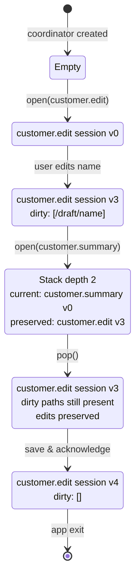
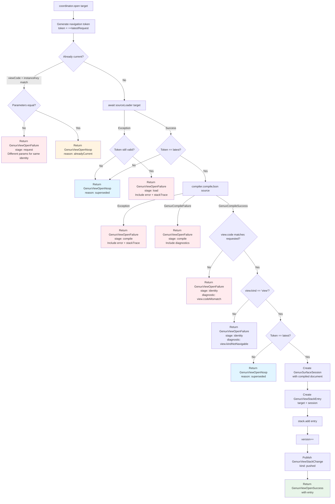
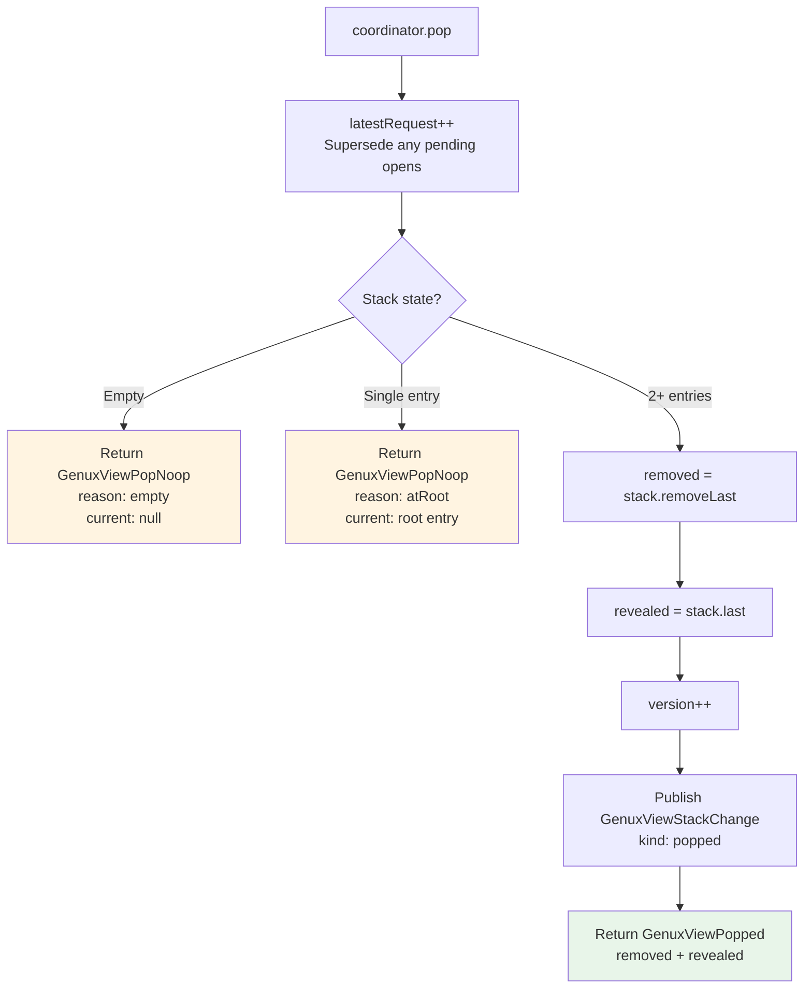
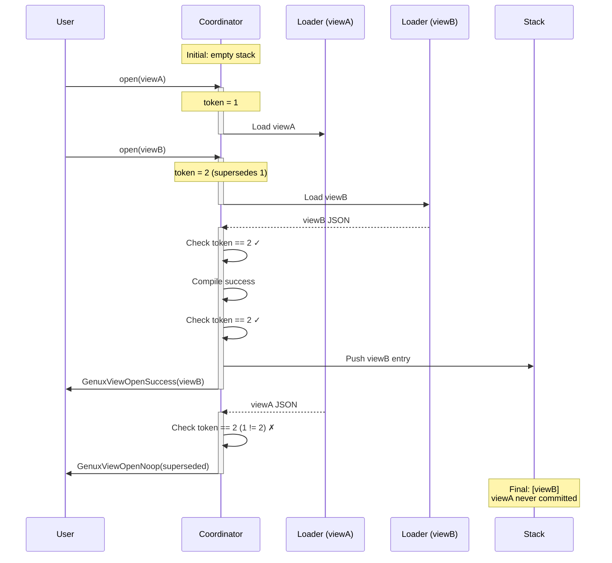
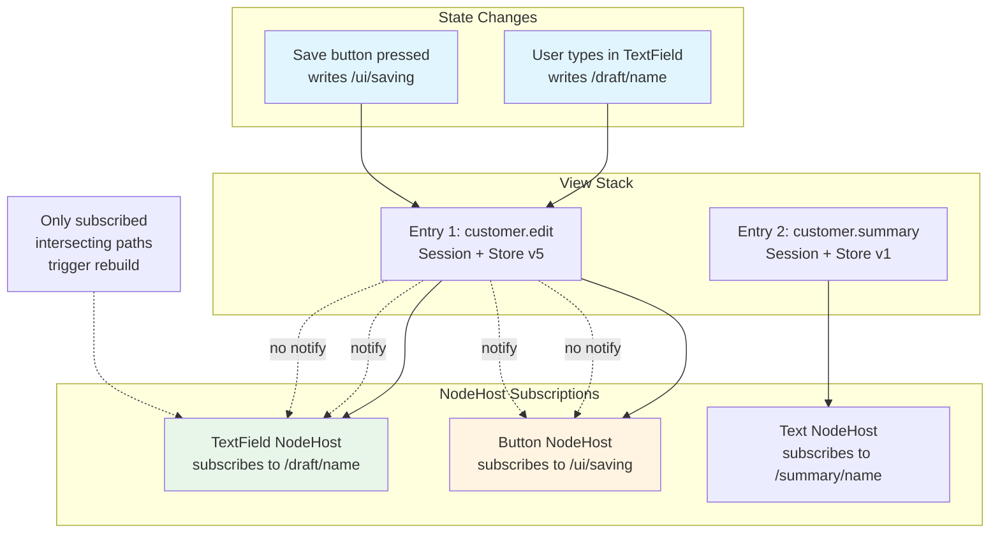
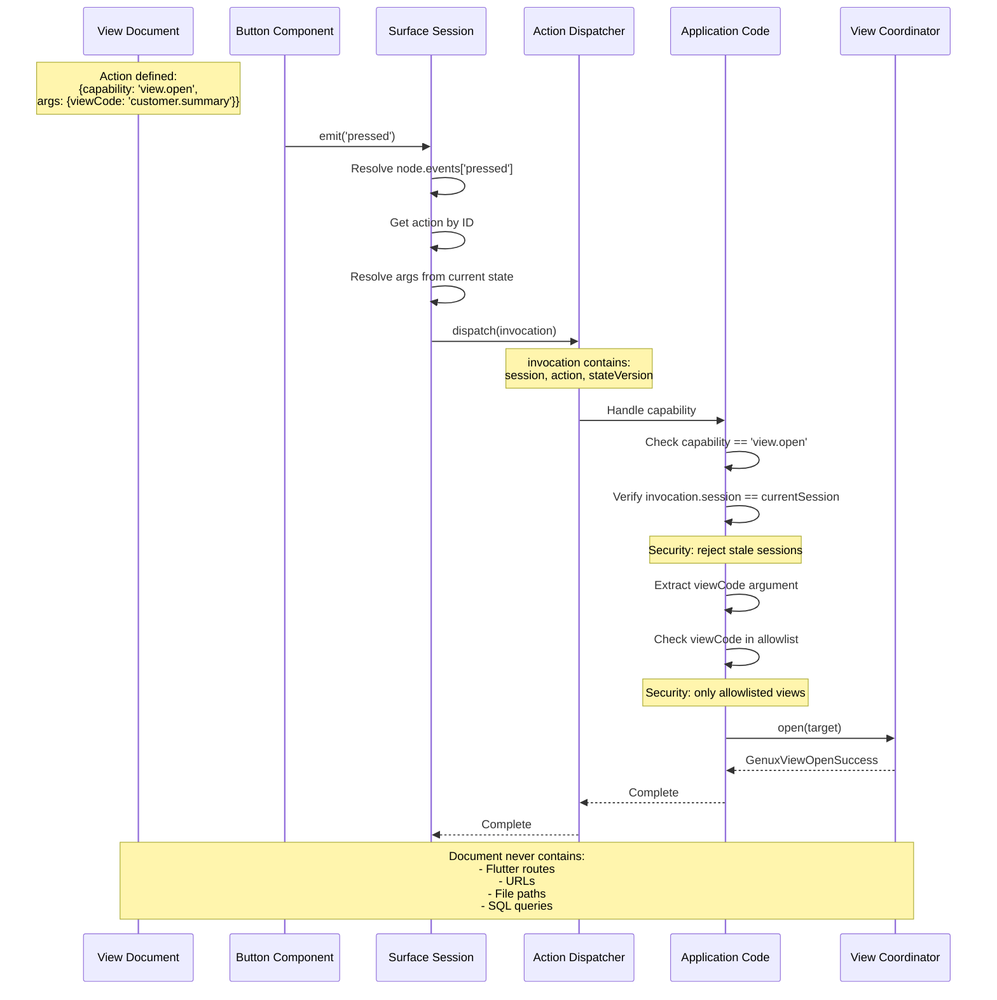
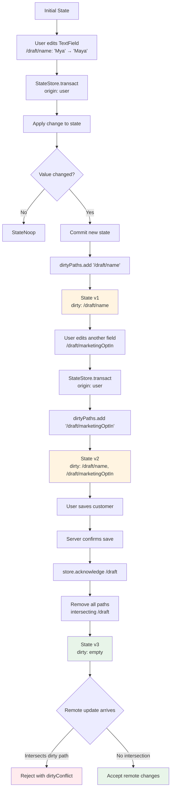
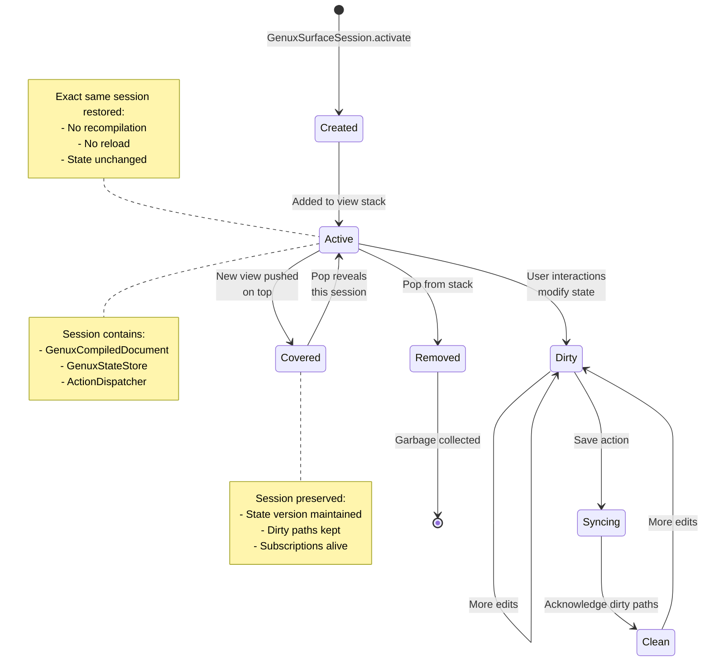
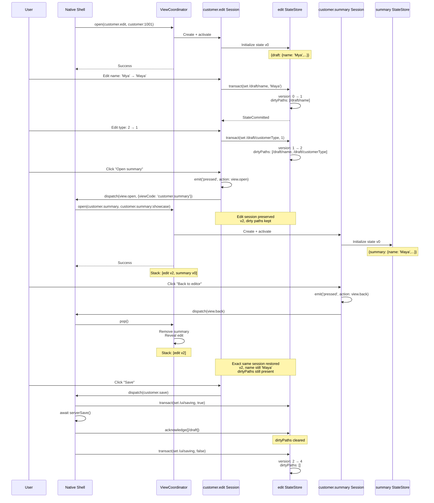
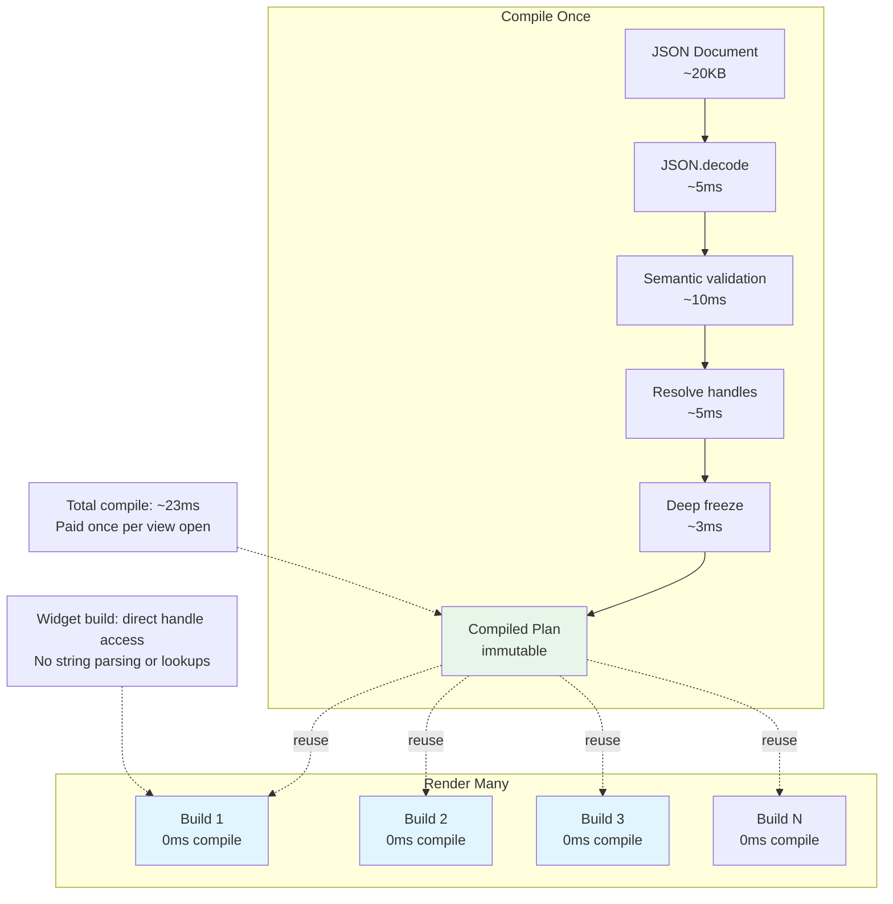

# MultiView Implementation Details

## Stack Navigation Flow



## Detailed Open Pipeline



## Pop Operation Flow



## Race Condition Scenarios



## State Subscription Model



## Identity Resolution

```mermaid
graph TD
    subgraph "Identity Components"
        ViewCode[viewCode<br/>stable: 'customer.edit']
        InstanceKey[instanceKey<br/>logical: 'customer:1001']
        Parameters[parameters<br/>immutable: {customerId: 1001}]
    end
    
    subgraph "Identity Rules"
        Rule1[Same viewCode + instanceKey<br/>+ same parameters<br/>→ No-op do not reload]
        Rule2[Same viewCode + instanceKey<br/>+ different parameters<br/>→ Reject as conflict]
        Rule3[Different viewCode OR instanceKey<br/>→ New independent session]
    end
    
    ViewCode --> Identity[View Target Identity<br/>viewCode, instanceKey]
    InstanceKey --> Identity
    Parameters -.provided to.-> Loader[Source Loader]
    
    Identity --> Rule1
    Identity --> Rule2
    Identity --> Rule3
    
    Rule1 --> Noop[GenuxViewOpenNoop<br/>alreadyCurrent]
    Rule2 --> Failure[GenuxViewOpenFailure<br/>request stage]
    Rule3 --> Success[GenuxViewOpenSuccess<br/>new stack entry]
    
    style Identity fill:#fff4e1
    style Rule1 fill:#e8f5e9
    style Rule2 fill:#ffebee
    style Rule3 fill:#e1f5ff
```

## Semantic Navigation Handling



## Dirty Path Tracking



## Session Lifecycle



## Complete Example: Customer Workflow



## Performance Characteristics



