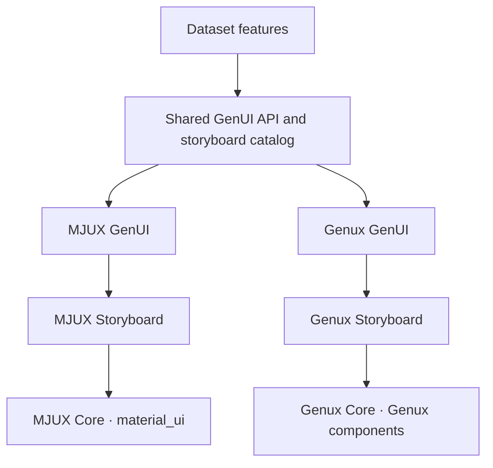

# MJUX development guideline

**Status:** Proposed development plan.

MJUX (Material JSON UX) is the first implementation of Dataset's JSON-driven
UI. Build it on Flutter 3.50.0 or later and the standalone `material_ui`
package so Dataset can start using
storyboard templates while Genux components are developed in parallel. Genux
will later provide its own Storyboard and GenUI engine. Dataset should be able
to switch implementations without rewriting the surface specifications,
bindings, or event handlers for compatible templates.

## Package structure

| Layer | MJUX | Genux |
| --- | --- | --- |
| **Core** | Reusable components built on `material_ui`. Owns styling, layout primitives, and component interactions. | Reusable Genux components, following Genux's [UI dependency rules](../README.md). |
| **Storyboard** | Ready-to-use template definitions assembled from MJUX components. Publishes supported template IDs, versions, inputs, and events. | Genux implementations of the storyboard items used by Dataset. Compatible items publish the same IDs, versions, inputs, and events. |
| **GenUI** | Engine that validates a surface request, resolves a storyboard template, binds data, renders the surface, and emits events. | An independent engine with the same Dataset-facing API and observable behavior. |

Dataset feature code uses the shared GenUI API and the public storyboard
catalog. The Dataset app setup supplies the selected implementation. Each
engine uses its own storyboard and component library. The shared contract
contains the public interface, schemas, template descriptors, and conformance
fixtures. Keep widget types, theme objects, and renderer-specific options out
of the Dataset-facing contract.

## Dataset-facing contract

A **template** is a reusable storyboard item. A **surface** is one mounted
instance of a template. Its instance ID identifies the target of updates and
events. Two surfaces can use the same template version and hold separate data
and state.

Define these parts of the contract with the first Dataset workflow:

| Part | What to specify |
| --- | --- |
| UI specification | Contract version, surface ID, template ID and version, and the options declared by that template. Use semantic IDs such as `record.edit`; resolve component choices in Storyboard. |
| Bindings | Named template slots, their types, which slots accept edits, and how they map to Dataset metadata or supplied data. Define required values, defaults, and how to distinguish omitted values from explicit nulls. |
| Data and state | Initial values and the supported update operation. Define when a host update replaces local state and how refreshes interact with unsaved edits. Keep state isolated per surface. |
| Events | Surface ID, declared event name, and a typed payload. Specify when an event is emitted and how Dataset reports pending, success, validation, or failure states back to the surface. |
| Lifecycle and errors | How to open, render, update, and dispose of a surface. Define errors for malformed requests, missing templates, unsupported versions, and invalid bindings. Return a useful location or field name for invalid input. Ignore late updates for disposed instances. |

Version the GenUI contract separately from individual templates. A change that
breaks an input, event payload, or behavior Dataset relies on requires a new
contract or template version, as appropriate. Each engine
declares the versions it supports. Resolve compatibility before opening the
surface and report an unsupported version explicitly.

For example, Dataset could open `customer.edit.42` using `record.edit` version
1, supply the binding and value for `customerName`, and receive a
`record.saveRequested` event with the proposed changes. MJUX and Genux can
lay out the form differently while agreeing on when the save event is emitted,
what it contains, and how the surface shows the result. These names are
illustrative and do not define the wire schema.

## Runtime responsibilities

- **GenUI** validates the request before rendering, resolves only registered
  templates and events, and manages interaction state for each mounted surface.
  Validate types and references and set size limits for accepted payloads.
  Treat JSON as declarative input. A requested action becomes an event for the
  host, and the engine recognizes actions through the registered template
  contract.
- **Dataset** resolves metadata and queries, fetches data, authorizes actions,
  validates business rules, and persists changes through its services. It
  handles request cancellation, retries, and conflicts and supplies display
  states to the surface. Keep credentials and raw record values out of engine
  diagnostics.
- **Storyboard** describes each item's slots, states, and events. It
  specifies observable behavior such as when validation appears and how a
  selection is retained. Its implementation assembles components, localized
  labels, and responsive layouts for its own renderer.
- **Core** implements controls with typed properties and callbacks, including
  keyboard, pointer, touch, and accessibility semantics as applicable.
  Keep Dataset metadata and business logic in the host.

Dataset currently recognizes both `legacy_columns` and `entity_fields`
binding models. Use Dataset's existing metadata and conversion layer to resolve
references and prepare the values supplied to GenUI. Preserve field direction,
omission rules, large integers represented as strings, and decimal precision
across the UI boundary. Check the existing Dataset
`lib/core/schema/schema_bundle.dart` and `lib/core/format/format_transformer.dart`
when defining and testing the first binding contract.

## Development sequence

1. **Define the first storyboard item.** Start with a Dataset record editor
   that loads data, accepts a text edit and a searchable selection, validates
   input, and requests a save. Record the template contract and representative
   requests, updates, and expected events as fixtures.
2. **Build and integrate MJUX.** Implement the necessary Material components,
   template, and GenUI operations. Mount the surface inside Dataset's existing
   shell. Verify theme and localization behavior at that boundary, since
   Dataset currently uses the Flutter SDK's Material library. Exercise
   save, refresh, and failure paths through Dataset.
3. **Develop Genux Core in parallel.** Keep an inventory of the behaviors
   Dataset actually uses by template and version. Map each behavior to the
   relevant Genux component or composition and use missing behaviors to order
   the work. The [missing-components list](missing-components-list.md) can
   help identify candidates.
4. **Implement Genux Storyboard and GenUI after the 90% Genux Core milestone.**
   Use the same public contract and fixtures. Prove the integration on the
   first surface, then expand to the other Dataset templates. Choose the
   implementation when opening a surface. Keep it for the surface's lifetime
   so active edits and pending actions have a stable owner.
5. **Move eligible surfaces to Genux.** Track which surfaces still require
   MJUX and retain a way to restore MJUX for new instances during rollout.
   Retire the MJUX dependency from Dataset after all required surfaces have a
   verified replacement and the rollout is accepted.

## Verification and migration criteria

Run the same contract fixtures against both engines. Compare accepted requests,
bound values, validation results, event payloads, and lifecycle behavior.
Verify that unsupported template versions and invalid updates fail predictably.
Include separate tests for multiple instances, save success and failure,
refresh during an edit, and disposal while an update is pending. Check
keyboard traversal, visible focus, screen reader labels, text scaling, and
responsive layout on the platforms Dataset supports. Verify styling within
each implementation and use contract behavior for cross-engine comparisons.

For the **90% Genux Core milestone**, use a versioned inventory of the
component and composition behaviors Dataset uses in MJUX. Each entry records
the applicable storyboard items and versions, the behavior, its criticality,
and its verification result. Divide the number of applicable behaviors
verified with Genux Core components or compositions by the number of
applicable behaviors in the inventory. Count a shared behavior once and record
every surface that uses it. Component tests or a small gallery demonstration
can supply evidence before the Genux engine exists.

Switch an individual surface only when all of its required workflow behaviors
pass through the Genux engine, including binding and events. Record which
remaining surfaces continue to use MJUX.

Genux's [experimental JSON preview](json-and-a2ui-readiness.md) is a separate
format. Define and test the Dataset contract explicitly as part of MJUX
development.
