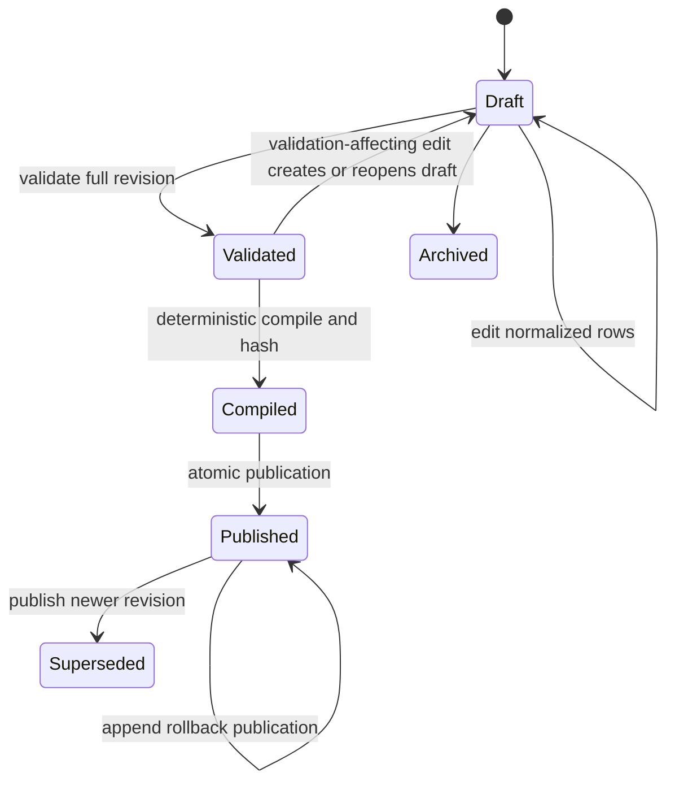

# Relational GenUX authoring model

Status: design contract for CloudX authoring and the trusted Aix publication
compiler. No migration has been applied to the Aix repository yet.

## Decision

The existing experimental `metadata.genux.vd JSONB` design will not be the source
of truth. GenUX authoring is normalized like MetaX so the database can enforce
identity, ownership, ordering, types, QueryX references, lifecycle, impact
analysis, and publication rules.

JSONB remains appropriate for bounded structured literals and the immutable
compiled delivery artifact. It is not appropriate for hiding the editable View
graph, actions, routes, QueryX calls, or revision lifecycle.

The table names below are the intended logical names. Their final PostgreSQL
schema namespace should follow the active MetaX consolidation rather than preserve
the currently disconnected `metadata.genux` prototype.

## Shared row conventions

Logical roots follow current MetaX conventions:

- `i`: generated Aix 64-bit identity;
- `d`: epoch-millisecond modification token;
- `e`: editor identity;
- `a`: active/locked status bits only;
- `di`: DomainX scope where the row is independently owned;
- `c`: immutable machine code; and
- `n`: display name.

Revision children inherit View, domain, and catalog context through foreign keys
instead of duplicating it. Publication state is an explicit lifecycle value and
is not overloaded into `a`.

IDs that can exceed JavaScript's exact integer range are serialized as strings in
runtime JSON.

## View authoring tables

| Table | Responsibility |
| --- | --- |
| `viewx` | Stable View or Partial View identity: standard fields, kind, and current published pointer. |
| `viewrevx` | Monotonic revision, base revision, lifecycle, pinned catalog, compiler contract, and change note. |
| `viewnodex` | Component instances owned by one revision with stable node codes. |
| `viewedgex` | Parent, child, named slot, and ordinal; exactly one parent per non-root node. |
| `viewpropx` | Typed static property or literal input assignment for a node. |
| `viewbindx` | Node channel to canonical JSON Pointer and null/fallback policy. Direction is inferred from the catalog channel. |
| `vieweventx` | Node event to a View action. |
| `viewactionx` | Stable semantic action definition and action kind. |
| `viewargx` | Typed action argument sourced from a literal, state binding, or trusted context value. |
| `viewcallx` | Server-side data/action call with foreign keys to QueryX and optional result state path. |
| `viewcallargx` | ParamX mapping sourced from a literal, binding, or trusted context. |
| `viewrulex` | Bounded validation, visibility, enabled, or presentation rule with declared state dependencies. |
| `viewincludex` | Partial View inclusion with an exact pinned revision and explicit parameter mapping. |

Important constraints include:

- unique `(di, c)` for stable Views;
- unique `(view_i, revision)` for revisions;
- at most one mutable draft per View/editor workflow;
- unique `(revision_i, node_code)`;
- unique `(parent_node_i, slot_code, ordinal)`;
- one parent for every non-root node;
- node, edge, property, binding, event, and action rows must belong to the same
  revision;
- property/channel/event/slot references must belong to the revision's pinned
  catalog;
- QueryX and ParamX mappings must match; and
- published revision children are immutable.

Graph reachability, cycles, required slots, and cross-row catalog rules are checked
by the trusted server compiler in one transaction because they are clearer as
whole-revision validation than individual row checks.

## Catalog registry tables

| Table | Responsibility |
| --- | --- |
| `uicatalogx` | Immutable released catalog identity, positive integer release version, optional human label, runtime range, manifest checksum, and release state. |
| `uicomponentx` | Component code/version and cost/capability flags within a catalog. |
| `uipropertyx` | Static property type, required/default policy, and constraints. |
| `uichannelx` | Channel code, `input` or `state` direction, value type, required flag, and constraints. |
| `uieventx` | Event code and payload type. |
| `uislotx` | Slot code, minimum/maximum cardinality, and accepted component/Partial policies. |

The Genux Dart release is authoritative for renderer implementations and exports a
canonical manifest. Aix imports that manifest into these tables as an immutable
catalog release. Runtime compatibility uses an exact positive integer release
version plus checksum; an optional label such as `1.0 Preview` is display metadata,
not a compatibility key. CloudX reads the relational copy for editing and
validation. A manifest checksum mismatch prevents publication or client
activation.

Changing a released component contract creates a new component/catalog version.
Released contracts are never edited in place.

## Artifact and publication tables

| Table | Responsibility |
| --- | --- |
| `viewartifactx` | Immutable canonical compiled structure, schema/catalog versions, SHA-256, counts, compiler version, and compile timestamp. |
| `viewpublishx` | Append-only publication record by environment/channel, publisher, time, sequence, and optional rollback origin. |

`viewartifactx.document JSONB` is derived, not authored. It contains the flattened
validated View structure without user-specific data. An insert-only rule protects
published artifacts.

`viewpublishx` preserves history. Rollback appends a publication pointing at an
older valid artifact; it does not mutate that artifact or the historical revision.
A current serving pointer can live on `viewx` for one environment or in a separate
small pointer table when multiple release channels are required.

## Revision lifecycle

Recommended publication transaction, initiated by CloudX and executed by the
trusted server compiler:

1. Clone the current published revision into a new draft and record its base
   revision for optimistic concurrency.
2. Validate catalog members, types, graph invariants, bindings, Partial pins,
   MetaX fields, QueryX/ParamX calls, capabilities, resource limits, and author
   permissions.
3. Mark the revision validated and compile canonical bytes deterministically.
4. Insert an immutable artifact, hash it, recompile, and verify the hash.
5. Under a publication lock, verify the base revision is still current, append a
   publication record, atomically move the serving pointer, supersede the old
   revision, and bump the UI metadata version.
6. Any later edit creates a new revision.

## Relational versus JSONB rule

Keep relational:

- stable identity, DomainX scope, lifecycle, revision, and publication;
- graph nodes, edges, slots, and ordering;
- catalog members and compatibility;
- binding paths and channel ownership;
- MetaX, QueryX, FieldX, and ParamX references;
- event/action/call targets;
- permissions and audit; and
- Partial View pins and parameter mappings.

Use JSONB only for:

- structured literal values that are already typed by a catalog property;
- small schema-validated rule operands or extension bags;
- immutable imported catalog manifests and optional diagnostics; and
- the final immutable compiled artifact.

Never store executable Dart, JavaScript, SQL, arbitrary endpoints, raw HTTP
methods, or unrestricted routes in any GenUX value.

## Serving contract

CloudX initiates publication; the trusted server compiler validates the draft and
stores the immutable artifact in Aix. QueryHub then serves only a published
artifact to an authenticated and authorized runtime. It combines that structure
with authorized initial state and compatibility context to produce
`aix.genux/1.0`.

Authoring query IDs remain server-side. The client receives semantic capabilities;
the backend maps them to QueryX operations and performs authorization and
validation for every invocation.

The current Aix prototype needs two related corrections before live delivery:

- authenticated server context must be injected into QueryHub instead of trusting
  client-supplied user/domain fields; and
- the metadata version must include GenUX catalog, View, artifact, and relevant
  QueryX/MetaX changes rather than only a subset of table metadata.
